# Greywarden

Self-hosted security-management system that replaces the risk / decision / incident / asset spreadsheets,
built to grow into a security-operations dashboard.

> **Alpha.** Greywarden is used in production by its author, but the schema and features still change between
> releases. Take a backup before every upgrade (`scripts/deploy.sh` does). See [CHANGELOG.md](CHANGELOG.md),
> [SECURITY.md](SECURITY.md) to report a vulnerability or verify a release, and [CONTRIBUTING.md](CONTRIBUTING.md).

## Quick start

Needs Docker with the Compose plugin.

```bash
git clone https://github.com/jhmonteseguro/greywarden.git && cd greywarden
scripts/up.sh --seed      # creates .env, starts the stack, applies migrations, loads demo data
```

Open **http://127.0.0.1:8080** and sign in as `admin` / `ChangeMe!2026` (you must change it at first sign-in),
or as `analyst` / `Greywarden!Demo1` to explore the demo data. Stop with `scripts/down.sh`.
For real data, see [Production](#production); for the full setup, see [Development setup](#development-setup).

## Features

* **Risk Register**: 5×5 inherent and residual scoring, treatment, acceptance, a heatmap, overdue flags,
  and a flag when a risk relies on a control that is retired, not effective or overdue for testing
* **Control Register**: controls with owner, type, status, target dates, effectiveness tests and a test schedule;
  links to risks, decisions, incidents (detected / failed / added in response), ATT&CK mitigations, and the
  **ISO 27001:2022 Statement of Applicability**, **Cyber Essentials** and **SOC 2** readiness views, a **NIST CSF 2.0**
  profile and an **NCSC CAF 4.0** assessment (each can be switched off in Admin › Settings). Controls can also be
  **device checks** that every applicable device in the inventory is checked against
* **Decision Log**: options, rationale, supersession chain, links to risks and incidents
* **Incident Log**: NIST lifecycle, an incident timeline, the 72-hour regulator deadline with a countdown, response metrics,
  and a PDF incident report for management (interim while open, final once closed) written in plain English
* **Device Inventory**: lifecycle, network data, and posture against the device checks (pass / fail / not assessed)
* **Cloud Inventory**: cloud accounts (AWS, Azure, Google Cloud, Cloudflare, Google Workspace, Microsoft 365, GitHub...)
  and the assets in them (instances, VPCs, security groups, buckets, databases, IAM roles, DNS zones, repositories...)
  with exposure, encryption, OS support and posture against **cloud checks** from the Control Register, linked to
  risks, incidents and decisions; imported from AWS, Azure and Google Cloud inventory exports and synced from Cloudflare
* **Edge findings**: pulls the zone's Cloudflare traffic analytics every 15 minutes, flags addresses that probe for
  secrets and admin pages, enumerate paths, send attack payloads or use scanner tools (scored and explained), and
  recommends what to do: raise an incident when a sensitive path answered 200, block for a few days, block the probe
  paths for everyone with a suggested WAF rule, or block a network that keeps sending scanners
* **Dashboard**: KPI tiles, residual heatmap, incident trend, device posture, a "needs attention" list,
  control effectiveness with progress against each framework switched on, recent activity
* **MITRE ATT&CK** (Enterprise v20, bundled for offline use): techniques observed on incidents, threat techniques on risks,
  mitigations implemented by controls or adopted by decisions, an ATT&CK matrix shaded by incidents or risks,
  mitigation coverage and gap analysis, device platforms and device checks mapped to mitigations, and a dashboard panel
* **Threat intel: IP / ASN investigation**: one explainable 0–100 assessment built from 16 free sources (registries,
  routing, reputation, exposure, DNS blocklists and 13 locally cached threat feeds), raw WHOIS / RDAP, analyst verdicts
  and notes, correlation with incidents and devices, pivots to 25+ external tools, and a **blocklist** of IPs, networks and ASNs
  with expiry, incident links and copy-ready firewall rules
* **Platform**: roles (admin / analyst / viewer), per-field audit trail, soft delete (archive), global search

Stack: **PHP 8.3 · Yii 2.0 (basic template, one module per domain) · MariaDB 11.4 LTS · nginx ·
Bootstrap 5.3 (yii2-bootstrap5) · Bootstrap Icons · Chart.js 4**. All front-end assets are installed by
Composer and self-hosted. Nothing loads from a CDN at runtime, and there is no Node build step.

---

## Development setup

```bash
cp .env.example .env      # adjust passwords if you like (works as-is for local dev)
make up                   # builds the PHP image, starts nginx + php-fpm + mariadb + the scheduler, runs composer install
make migrate              # creates the schema, roles and the initial admin
make seed                 # OPTIONAL: demo data (25 risks, 18 controls, 15 decisions, 20 incidents, 40 devices)
```

Open **http://127.0.0.1:8080** and sign in.

| User | Password | Role | Notes |
|---|---|---|---|
| `admin` (`ADMIN_USERNAME`) | `ADMIN_PASSWORD` from `.env` (default `ChangeMe!2026`) | Admin | Must change password at first sign-in |
| `analyst` | `DEMO_PASSWORD` (default `Greywarden!Demo1`) | Analyst | Created by `make seed` only |
| `jpatel` | `DEMO_PASSWORD` | Analyst | Created by `make seed` only |
| `viewer` | `DEMO_PASSWORD` | Viewer (read-only) | Created by `make seed` only |

Other admins: `make create-admin` (uses the `ADMIN_*` values in `.env`) or
`make create-admin ARGS="jdoe jdoe@example.org 'Str0ng!Passw0rd'"`.
Forgotten password: `make yii ARGS="user/reset-password admin 'New!Passw0rd1'"`.

### Start / stop scripts (no `make` needed)

```bash
scripts/up.sh             # create .env if missing, start the stack, wait for Composer, apply migrations
scripts/up.sh --seed      # ...and load the demo data (first run)
scripts/up.sh --build     # rebuild the PHP image first (after changing docker/php)
scripts/down.sh           # stop and remove containers; data stays in the db-data volume
scripts/down.sh --wipe    # also delete the volumes (ALL data). Asks for confirmation first
```

Both scripts can be run from any directory, and both accept `--help`.

## Production

Run production as its **own stack in its own checkout**, separate from the development one. Development
bind-mounts `./src`, so every edit is live there; production runs a released version built into the images and only
changes when you deploy.

| | Development | Production |
|---|---|---|
| Checkout | your working copy | a separate clone, on a release tag |
| Code | `./src` bind-mounted, debug toolbar | built into `greywarden-php:prod` / `greywarden-nginx:prod` (`composer --no-dev`, opcache never re-checks files) |
| Data | demo data (`make seed`) | your real data |
| `.env` | `YII_ENV=dev`, no external write credentials | `YII_ENV=prod`, `YII_DEBUG=0`, `COMPOSE_FILE` below |

Each stack needs its own `COMPOSE_PROJECT_NAME`, `APP_PORT` and `DB_HOST_PORT` in `.env`, so their containers and
volumes stay apart. Keep credentials that act on real systems (such as `CLOUDFLARE_API_TOKEN`) out of the
development `.env`.

**Set up production** (once):

```bash
git clone https://github.com/jhmonteseguro/greywarden.git greywarden-prod && cd greywarden-prod
cp .env.example .env && chmod 600 .env     # new passwords; YII_DEBUG=0, YII_ENV=prod, COOKIE_SECURE=1 behind HTTPS
echo 'COMPOSE_FILE=docker-compose.yml:docker-compose.prod.yml' >> .env
scripts/deploy.sh v0.7.0-alpha             # verifies the tag signature, builds, starts and migrates
```

**Upgrade**: `scripts/deploy.sh <tag>` (or `make deploy REF=<tag>`). It refuses a tag without a valid PGP signature
(import the release key into gpg first: SECURITY.md, Verifying releases) and a checkout with local changes. It takes a backup, checks the tag out,
rebuilds the images, restarts the stack and runs the migrations. To go back, deploy the previous tag and, if
migrations ran, restore the backup it took.

In production, `runtime/` (logs, sessions, cache, the cookie key) and the published asset bundles live in Docker
volumes, so they survive upgrades, and uploads stay in `./storage` next to the checkout. `make seed`,
`scripts/up.sh --seed` and the test scripts refuse to run in a production checkout.

## Screenshots

| Dashboard | Risk register | Incident timeline |
|---|---|---|
| 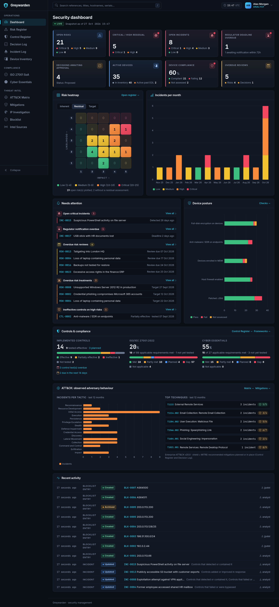 | 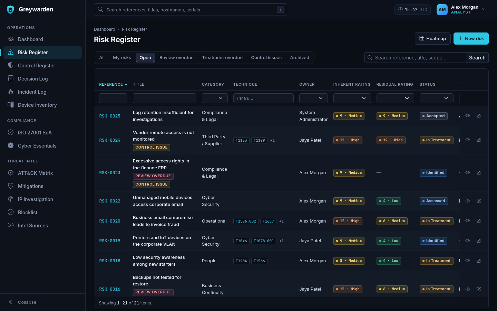 | 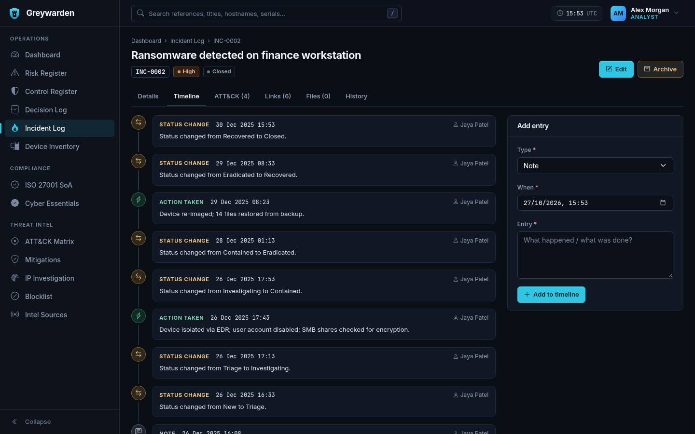 |

| Control register | Control | ISO 27001 Statement of Applicability |
|---|---|---|
| 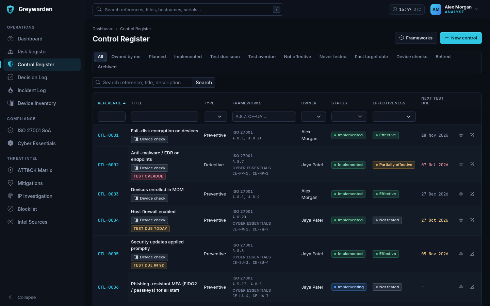 | 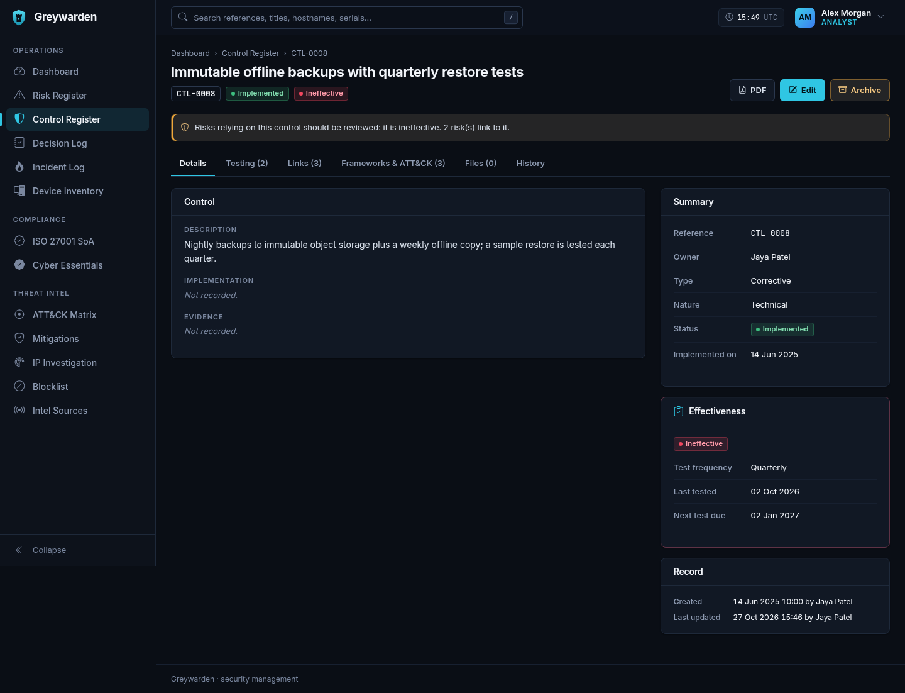 | 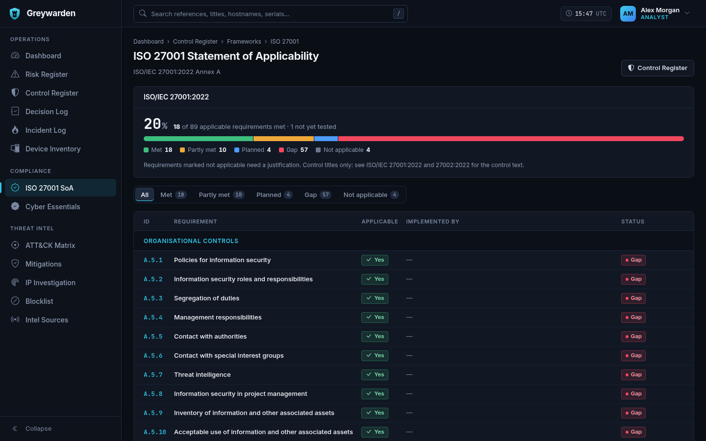 |

| Risk heatmap | Device inventory | Audit history |
|---|---|---|
| 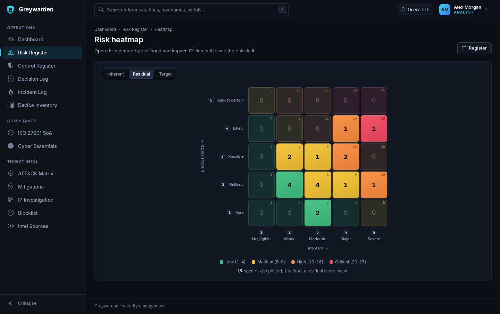 | 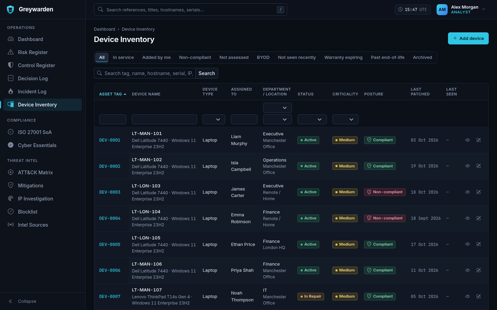 | 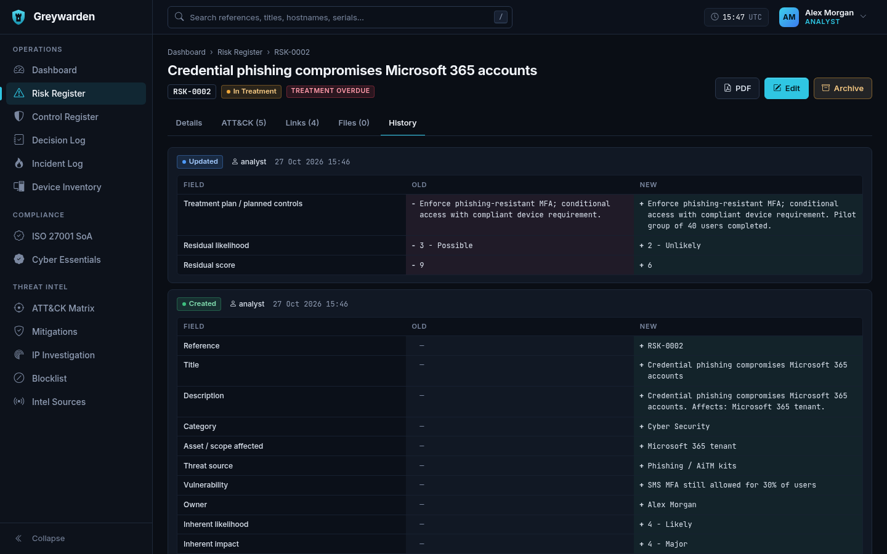 |

| ATT&CK matrix | ATT&CK technique | ATT&CK mitigations |
|---|---|---|
| 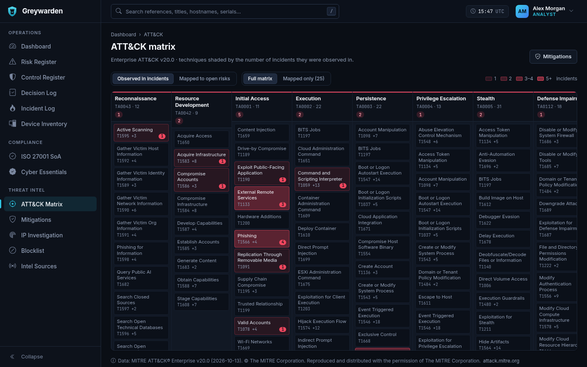 | 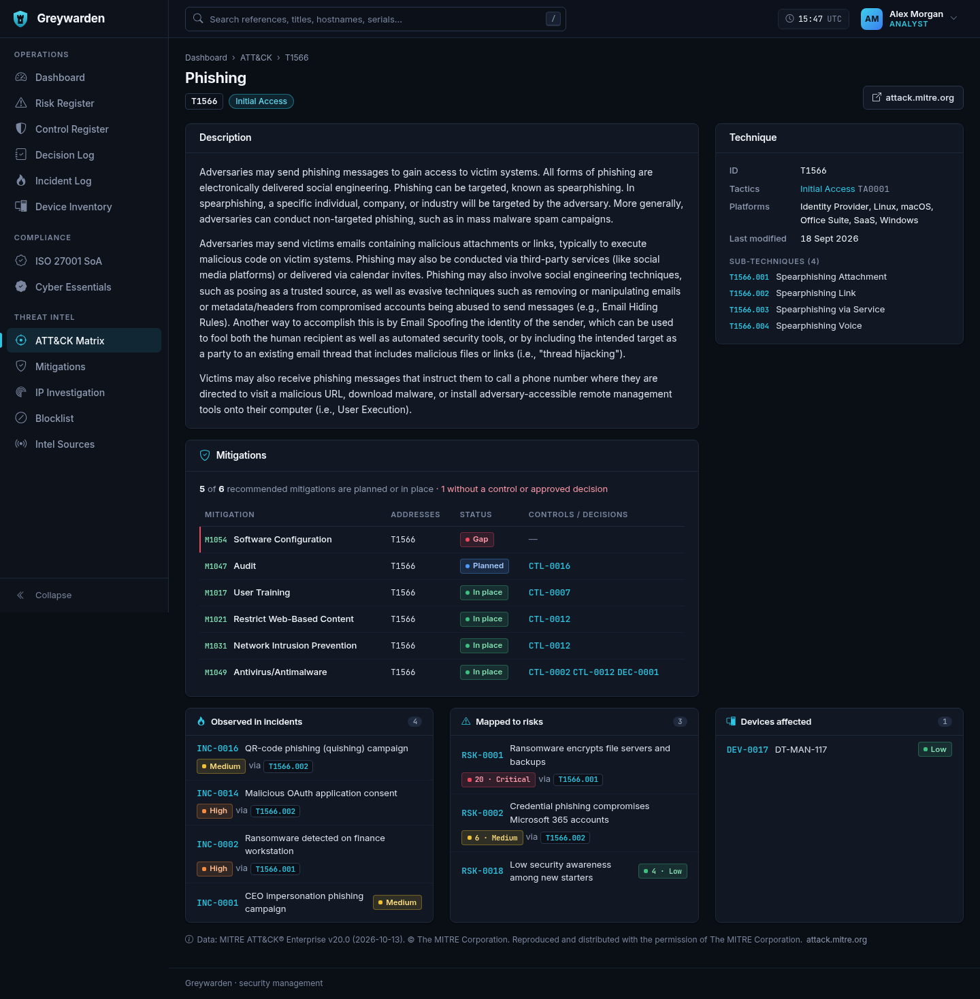 | 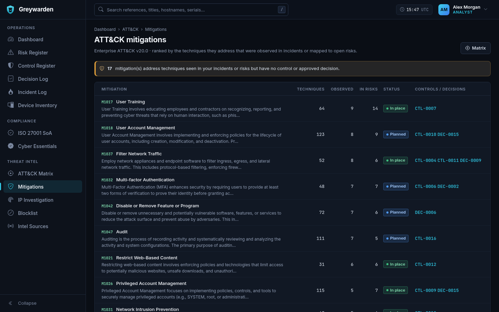 |

| IP investigation | Investigation console | Blocklist |
|---|---|---|
| 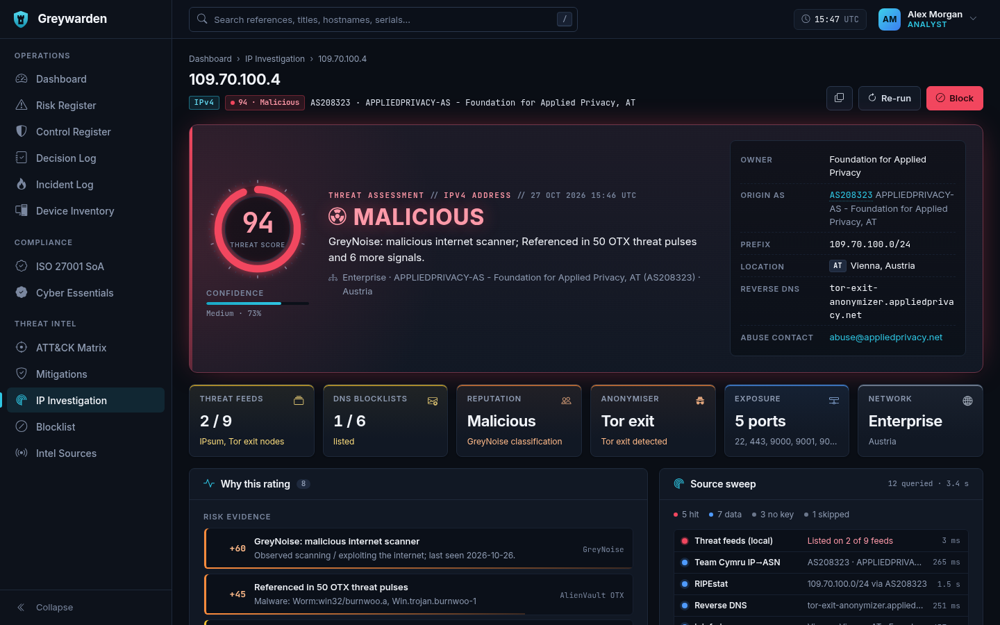 | 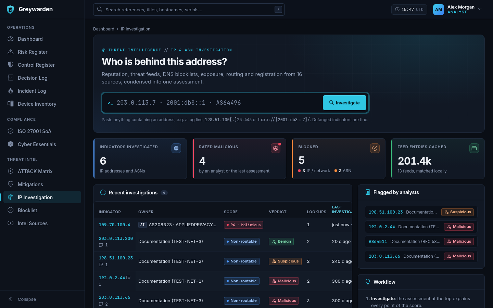 | 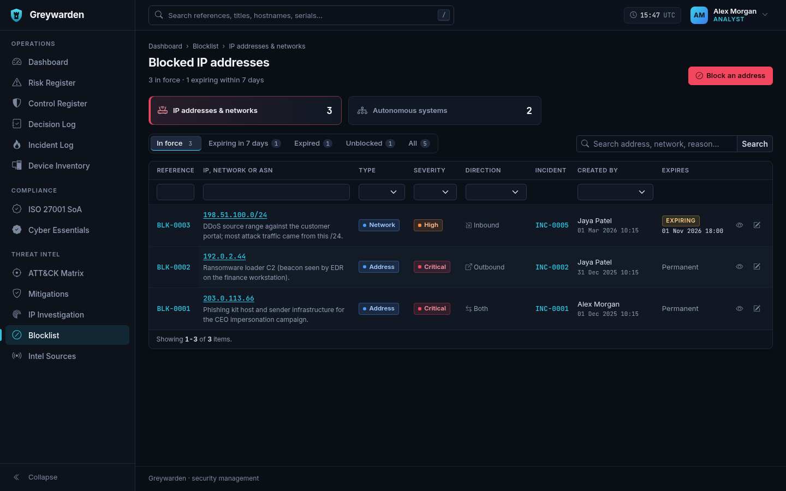 |

More screenshots, including Cyber Essentials, branding settings and the mobile views, are in
[`docs/screenshots/`](docs/screenshots/). All of them show the demo data (`scripts/up.sh --seed`).

## Containers

| Service | Image | Purpose | Host port |
|---|---|---|---|
| `nginx` | nginx:1.27-alpine | Web server, static assets, security headers | `127.0.0.1:8080` |
| `php` | built from `docker/php` (php:8.3-fpm + pdo_mysql, intl, gd, zip, opcache, bcmath, exif + Composer) | Yii app, runs as uid/gid `APP_UID`/`APP_GID` (1000) | none |
| `db` | mariadb:11.4 | Database (named volume `db-data`, health-checked) | `127.0.0.1:3307` |

The source in `./src` is **bind-mounted** into `php` (and `src/web` read-only into `nginx`). Edit files
locally and refresh the page; opcache revalidates on every request. Because PHP runs as your uid, files that
Composer, Gii or the runtime create are owned by you. Uploaded files are stored in `./storage` (`attachments/`, `branding/`)
(bind-mounted at `/var/www/storage`, outside the web root and git); `make up` / `scripts/up.sh` create it.

## Makefile

| Command | What it does |
|---|---|
| `make up` / `make down` | start (building if needed) / stop containers. Data persists in the `db-data` volume |
| `make build` / `make rebuild` | rebuild the PHP image (rebuild = no cache) |
| `make logs [s=php]` | follow logs |
| `make shell` | bash inside the PHP container |
| `make composer ARGS="require vendor/pkg"` | run Composer |
| `make yii ARGS="migrate/history"` | run any Yii console command |
| `make migrate` | apply migrations |
| `make seed` / `make seed ARGS="--reset=1"` | load demo data / wipe domain data and reload it |
| `make create-admin` | create an admin from `.env` (or ARGS) |
| `make reset-db` | **drop** and recreate the database, then migrate (asks for confirmation) |
| `make test` | create + migrate the test DB (`DB_TEST_NAME`) and run PHPUnit (`unit` + `functional` suites) |
| `make test-all` | **everything**: the leak check and its tests, PHPUnit unit + functional suites and the HTTP smoke test, all against a fresh test DB that is seeded, served by a throwaway `gw-verify` container on 127.0.0.1:8099 and dropped afterwards (`scripts/run-all-tests.sh`). `ARGS="--no-smoke"` skips the smoke test, `ARGS="--coverage"` writes a coverage report to `src/runtime/coverage/` (HTML, Clover, per-directory summary; uses a pcov-enabled copy of the PHP image, never the running container) |
| `make smoke` | HTTP smoke test only: every page × every role, POST flows, lockout, CSRF (needs demo data). Refuses to run against the live database; `make test-all` runs it safely. Admin checks run as a temporary admin that is deleted afterwards |
| `make attack-status` / `make attack-update` | show the loaded MITRE ATT&CK release / download the latest release from MITRE, refresh the bundled snapshot and import it |
| `make import-devices FILE=devices.csv AS=<user> [DRY_RUN=1]` | import a Google Workspace device export (see [Device import](#device-import-google-workspace)) |
| `make import-cloud FILE=resources.json PROVIDER=aws\|azure\|gcp AS=<user> [ACCOUNT=ACC-0003] [DRY_RUN=1]` | import an AWS, Azure or Google Cloud inventory export (see [Importing cloud assets](#importing-cloud-assets)) |
| `make sync-cloudflare AS=<user> [DRY_RUN=1]` | add / refresh the Cloudflare zones as cloud assets, using `CLOUDFLARE_API_TOKEN` |
| `make edge-pull [AS=<user>] [MINUTES=60] [DRY_RUN=1]` / `make edge-status` | read the Cloudflare traffic since the last pull and update the edge findings now (the scheduler container also does this every `EDGE_PULL_INTERVAL` minutes) / show the zone's analytics limits and recent pulls (see [Edge findings](#edge-findings-cloudflare-traffic)) |
| `make expire-blocks` | take expired blocklist entries out of Cloudflare (`make edge-pull` does this too) |
| `make cloudflare-migrate [OLD_RULE="Block Bad Actors"] [DRY_RUN=1]` | one-off: move *Add to Cloudflare* entries from the old rule into the IP list and the **Greywarden Blocklist** rule (see [Threat intel](#threat-intel-ip--asn-investigation)) |
| `make intel-status` / `make intel-update` | show the local threat-feed status / download every feed now (stale feeds also refresh automatically in the background) |
| `make hooks` / `make leak-check [REV=<tag>]` | install the git hooks in `.githooks` / check the index (or a commit) for private files, terms and `.env` secrets (see [Leak check and git hooks](#leak-check-and-git-hooks)) |
| `make deploy REF=<tag>` | production checkout only: deploy a signed release tag (see [Production](#production)) |
| `make db-shell` | MariaDB client |
| `make backup` / `make restore FILE=...` | database dump / restore (see below) |

## Configuration (`.env`)

All configuration comes from `.env`, which docker compose passes to the PHP and scheduler containers. Key settings:

* `YII_DEBUG=1`, `YII_ENV=dev`: debug toolbar and Gii (`/gii`). For production use `YII_DEBUG=0`, `YII_ENV=prod`.
* `DEBUG_ALLOWED_IPS`: IPs/CIDRs that may see the debug toolbar and Gii. The default covers localhost and the
  Docker bridge networks. The web port is bound to 127.0.0.1, so only your machine can reach it.
* `COOKIE_VALIDATION_KEY`: leave empty to auto-generate `src/runtime/cookie_validation.key`.
* `COOKIE_SECURE=1` when served over HTTPS. `SESSION_TIMEOUT` is the idle timeout in seconds.
* `APP_TIMEZONE`: the timezone used for storing and displaying dates.
* `EDGE_PULL_INTERVAL` (default `15`, `0` = off): minutes between the scheduler container's Cloudflare edge pulls
  (see [Edge findings](#edge-findings-cloudflare-traffic)). The **scheduler** service (`php yii schedule/run`, same
  image as php) runs Greywarden's scheduled jobs, so no host crontab is needed; `make logs s=scheduler` shows them.
* `APP_NAME` (default `Greywarden`): the product name, used when no display name is set in **Admin › Settings**.
  Branding (display name, organisation, logo, sign-in text, PDF marking) is set there, not in `.env`; see
  [Branding](#branding-admin--settings).
* `DNS_PRIMARY` / `DNS_SECONDARY` (default `1.1.1.1` / `9.9.9.9`): the php container's upstream DNS servers.
  They are fixed because Docker otherwise copies the host's `resolv.conf` when the container starts. If that
  happens at boot before the network is up, every outbound lookup fails with "Could not resolve host" until
  the container is restarted. Spamhaus ZEN refuses queries from public resolvers, and through most home routers
  too. Set `SPAMHAUS_DQS_KEY` (a free [Data Query Service](https://www.spamhaus.com/data-access/free-data-query-service/)
  key) to query ZEN via `zen.dq.spamhaus.net`, which works through any resolver. Without the key, ZEN shows as
  *unavailable* rather than an error.

Threat intel works without any keys. Free API keys add sources and raise the assessment confidence:
`ABUSEIPDB_API_KEY`, `VIRUSTOTAL_API_KEY`, `ABUSECH_AUTH_KEY` (ThreatFox + URLhaus), `SPAMHAUS_DQS_KEY`; `GREYNOISE_API_KEY`, `OTX_API_KEY`
and `IPINFO_TOKEN` only raise rate limits. `INTEL_ENABLE_IPAPI=1` opts in to ip-api.com, whose free endpoint is
non-commercial only. `INTEL_DISABLE=otx,dnsbl,...` switches sources or feeds off. Run `make up` after changing
keys: it recreates the php container with the new `.env` (`make restart` does not reload `.env`).

*Add to Cloudflare* on the blocklist needs `CLOUDFLARE_API_TOKEN` and `CLOUDFLARE_ZONE_ID`. The token needs
**Zone › Zone WAF › Edit** (the rule), **Account › Account Filter Lists › Edit** (the IP list) and **Zone › Zone › Read**
(to find the zone's account; or set `CLOUDFLARE_ACCOUNT_ID`). `CLOUDFLARE_LIST_NAME` renames the IP list (default
`greywarden_blocklist`). `make sync-cloudflare` reuses the token to list zones (**Zone › Zone › Read**, no zone ID needed).
Edge findings (`make edge-pull`) read the zone's traffic analytics with the same token and zone ID, which needs
**Zone › Analytics › Read**.

Business rules live in `src/config/params.php`:

* the risk rating bands
* the 72h regulator window
* the device patch threshold (`device.patchMaxAgeDays`, default 30)
* the warranty warning window (60 days)
* when a synced device counts as not seen recently (`device.staleDays`, default 30) or missing (`device.staleCriticalDays`, default 90)
* the same for synced cloud assets (`cloud.staleDays`, default 30; `cloud.staleCriticalDays`, default 90)
* how early an operating system's end of support is flagged (`device.osWarningDays`, default 90), and extra or
  corrected end-of-support dates (`device.osEndOfSupport`: a regex matched against the lower-cased "os version" => `Y-m-d`)
* the password policy and lockout thresholds (5 failures per username or 20 per IP within 15 minutes gives a 15-minute lockout)

## Architecture

```
greywarden/
├── docs/         screenshots/
├── docker-compose.yml, Makefile, .env(.example), .editorconfig
├── docker/
│   ├── php/      Dockerfile, php.ini, fpm-pool.conf, entrypoint.sh (auto composer install)
│   └── nginx/    default.conf (security headers, CSP)
├── scripts/      up.sh / down.sh (start/stop), backup.sh (database + attachments), smoke-test.sh (HTTP smoke test), run-all-tests.sh (all suites)
└── src/                              Yii2 basic-template layout
    ├── assets/       AppAsset (theme css/js), BootstrapIconsAsset, ChartJsAsset, ChartAsset
    ├── behaviors/    AuditBehavior (per-field diff → audit_log), ReferenceBehavior (RSK-0001…)
    ├── commands/     SeedController (seed/demo), UserController (create-admin, reset-password, list),
    │                 AttackController (attack/status, attack/import, attack/update)
    ├── data/attack/  bundled MITRE ATT&CK Enterprise snapshot (enterprise-attack.json.gz) + licence notice
    ├── components/   CrudController, Rbac, Actor, Navigation, LoginThrottle, PasswordChangeGuard,
    │                 ReferenceGenerator, Migration (base class)
    ├── config/       web.php, console.php, common.php, db.php, params.php, bootstrap.php (env helpers)
    ├── controllers/  SiteController (login/logout/error), AccountController (profile/password), SearchController
    ├── helpers/      Badge (ALL status/severity badges), RiskMatrix (scoring + bands), Dt
    ├── migrations/   full schema, RBAC roles, admin user, default lookups
    ├── models/       User, LoginForm, PasswordForm, ProfileForm, PasswordPolicy, Lookup, AuditLog,
    │                 DomainRecord (base AR: audit, archive, links, references), DomainQuery
    ├── modules/
    │   ├── dashboard/  Module (widget list), widgets/ (one class per KPI tile / panel) + views
    │   ├── risk/       Risk, RiskQuery, RiskSearch, RiskController, widgets/RiskHeatmap
    │   ├── control/    Control, ControlTest, ControlQuery, ControlSearch, FrameworkRequirement,
    │   │               components/ (FrameworkCatalogue, FrameworkCoverage), ControlController, FrameworkController
    │   ├── decision/   Decision, DecisionSearch, DecisionController
    │   ├── incident/   Incident, IncidentTimeline, IncidentSearch, components/IncidentMetrics + IncidentWording (PDF report wording)
    │   ├── inventory/  Device, DeviceQuery, DeviceSearch, components/ (DevicePosture, DeviceCheck, DeviceChecks, DeviceImporter)
    │   ├── cloud/      CloudAccount, CloudAsset (+ Query / Search), components/ (CloudCatalogue, CloudCheck, CloudChecks,
    │   │               CloudPosture, CloudExport + Aws/Azure/GcpExport, CloudTypeMap, CloudImporter, CloudflareZones),
    │   │               AccountController, AssetController
    │   ├── attack/     MITRE ATT&CK: AttackTactic/Technique/Mitigation, components/ (StixParser, CatalogueImporter,
    │   │               Catalogue, Coverage, DeviceAttack, CloudAttack, AttackText), widgets/ (TechniqueTags, KillChain,
    │   │               MitigationCoverage), matrix / technique / mitigation pages
    │   └── admin/      users (UserForm, ResetPasswordForm), audit log, lookups, settings (BrandingForm, ComplianceForm)
    ├── tests/        PHPUnit: unit/ (models, components, commands) and functional/ (in-process HTTP through the
    │                 real controllers, RBAC and views; FunctionalTestCase). The bootstrap uses the test database only
    ├── views/        layouts/ (main, _sidebar, _topbar, _flash, auth), partials/, site/, account/, search/
    ├── widgets/      GridView, grid/*Column, ActiveForm, DetailView, QuickFilters, RecordActions,
    │                 LinkedRecords, AuditHistory, Chart
    └── web/          index.php, css/greywarden.css, js/greywarden.js, js/gw-charts.js
```

### Key concepts

* **Domain records** (`Risk`, `Control`, `Decision`, `Incident`, `Device`, `CloudAccount`, `CloudAsset`) extend `models/DomainRecord`, which attaches:
  * timestamps and blameable (`created_at/updated_at/created_by/updated_by`)
  * the `AuditBehavior`
  * reference generation (prefix `RSK`, `CTL`, `DEC`, `INC`, `DEV`, `ACC`, `CLD`; asset tags can be overridden)
  * archive / restore (`archived_at/archived_by`)
  * many-to-many link syncing (`linkDefinitions()`), with link changes included in the audit diff. A link can be
    scoped to rows of a shared table with `where` (incident ↔ control links carry a `role`)
* **Soft delete**: "Archive" hides a record. Analysts can archive and restore. Only admins can hard-delete,
  and only records that are already archived. Deletions are still audited.
* **Audit trail**: every create, update, archive, restore and delete is written to `audit_log` with the user, IP,
  user agent and a JSON `{"field": [old, new]}` diff. Sign-ins, failed sign-ins, lockouts and password changes
  are recorded too. Each record has a **History** tab, and admins get the filterable **Admin → Audit Log**.
* **RBAC** (`DbManager`, see `components/Rbac.php`):

  | Role | Permissions |
  |---|---|
  | viewer | `records.view` |
  | analyst | viewer + `records.manage` |
  | admin | analyst + `records.delete`, `users.manage`, `lookups.manage`, `audit.view`, `settings.manage` |

  Permissions are enforced by `AccessControl` in every controller. Views hide buttons with `Rbac::canManage()` and `Rbac::canDelete()`.
* **Security**:
  * bcrypt (cost 12)
  * CSRF on all POSTs
  * HttpOnly, SameSite=Lax session and CSRF cookies (Secure via `.env`)
  * session ID regenerated on login
  * login rate limiting and lockout (`login_attempt` table; admins can clear a lockout)
  * forced password change for admin-set passwords
  * disabled users are signed out immediately
  * nginx sends CSP, X-Frame-Options and nosniff headers

### Control Register and frameworks

* **Control** (`CTL-0001`…): title, description, implementation, evidence, owner, type (preventive / detective /
  corrective), nature (technical / administrative / physical), status (planned › implementing › implemented › retired),
  target date, implemented on, and a test frequency.
* **Effectiveness** is never edited directly. It comes from the latest **test** recorded on the control's Testing tab
  (`control_test`: date, result, method, findings, evidence, tester). *Not tested* until the first test. The next test is
  due one frequency after the last test; an implemented control on a schedule that was never tested is due from the day
  it was implemented. Test and effectiveness changes show in the control's History.
* **Test reminders**: tests due within `control.testDueSoonDays` (default 14, in `config/params.php`) get an amber
  *Test due in Nd* flag, the *Test due soon* filter and a *Needs attention* group; once the date passes they turn red
  (*Test overdue*) and flag the linked risks. There are no email reminders.
* **Links**: risks (from either side; implemented controls are the existing controls behind the residual score, planned
  ones the treatment), decisions (that introduced or changed the control), incidents with a role (*detected or contained
  it*, *failed or was bypassed*, *added or improved in response*, set on the incident form), ATT&CK mitigations, and
  ISO 27001 / Cyber Essentials / SOC 2 / NIST CSF / NCSC CAF requirements. The free-text "Existing controls" / "Treatment plan" fields on risks stay
  as context.
* **Weak controls**: a control is weak when it is retired, archived, tested partially effective or ineffective, overdue
  for testing, or past its target date. Open risks linked to one get a *Control issue* flag and appear under the
  *Control issues* filter. Ineffective controls on High/Critical risks, overdue tests and planned controls past their target
  date appear in the dashboard's *Needs attention*.
* **Frameworks** (`framework_requirement`, loaded from `src/data/frameworks/`): the 93 ISO/IEC 27001:2022 Annex A controls
  (IDs, themes and titles only: the control text is ISO copyright), 27 Cyber Essentials requirements across its five
  themes (paraphrased from the NCSC *Requirements for IT infrastructure*; check them against the current version before an
  assessment), the 61 SOC 2 Trust Services Criteria (AICPA 2017 with the 2022 revised points of focus; paraphrased, as
  the criteria text is AICPA copyright) and the 106 NIST CSF 2.0 subcategories (NIST's own text, generated from the CSF 2.0
  reference export; US government work) and the 41 NCSC CAF 4.0 contributing outcomes (titles and outcome statements from
  the CAF document, under the Open Government Licence v3.0; the indicators of good practice stay in the document). Each requirement takes the best state of its linked controls: **Met** (implemented, not found wanting;
  *not tested* is shown when none has been tested effective) › **Partly met** (implementing, or tested partially effective /
  ineffective) › **Planned** › **Gap**. Requirements can be marked **not applicable** with a mandatory justification:
  that is the Statement of Applicability (*Compliance → ISO 27001 SoA*). *Compliance → Cyber Essentials* adds the device
  checks mapped to Cyber Essentials with pass / fail / not assessed counts across in-service devices.
  *Compliance → SOC 2* covers Security (the common criteria, CC1–CC9) plus the optional categories chosen in Settings.
  *Compliance → NIST CSF 2.0* is the current profile: how far the controls achieve each outcome, grouped by category across
  Govern, Identify, Protect, Detect, Respond and Recover. *Compliance → NCSC CAF* reads met / partly met / gap as the
  CAF's achieved / partially achieved / not achieved, grouped by principle (A1–D2).
* **Switching frameworks off** (*Admin › Settings › Compliance frameworks*): every framework is on until an admin turns it
  off. A framework that is off disappears from the sidebar, the Frameworks page, the dashboard, search, the control form,
  view and PDF, and its pages return 404. Its applicability decisions and control mappings are kept (saving a control
  never drops links the form does not show), so switching it back on restores everything. The same applies to SOC 2
  categories (Availability, Confidentiality, Processing integrity, Privacy) left out of scope. Stored in the `setting`
  table as `framework.<name>` (`1` / `0`) and `framework.soc2.categories`; changes are audited.
* **Device checks**: a control with a *device check* applies to the device types (and ownership) you choose while it is
  implementing or implemented. *Manual* checks get a Pass / Fail / Not assessed select on the device form (`device_control`;
  no row = not assessed). *Patch age* checks pass when the device's *Last patched* date is within the control's maximum age.
  *Supported OS* checks fail once the device's OS is past its vendor end of support (`OsLifecycle`), and are not assessed
  when the OS or version has no known date; migration `m261028_000005` adds one (*Supported operating systems*, in force).
  A device is **non-compliant** if any applicable check fails, **not assessed** if none fails but some have no result, and
  **compliant** otherwise; `DevicePosture` (PHP) and `DeviceQuery` (SQL) implement the same rules. Migration
  `m261020_000003` turned the four fixed posture columns and the patch rule into CTL-0001…0005, keeping ticked boxes as
  *pass*, unticked as *fail*, and leaving synced devices that had nothing ticked as *not assessed*.

### MITRE ATT&CK

* **Catalogue**: `attack_tactic`, `attack_technique` (sub-techniques via `parent_id`), `attack_mitigation`, plus MITRE's
  technique → tactic and mitigation → technique mappings. Migration `m261019_000002` loads the bundled snapshot in
  `src/data/attack/`. `make attack-update` downloads the latest STIX bundle from
  [mitre-attack/attack-stix-data](https://github.com/mitre-attack/attack-stix-data), rewrites the snapshot (commit it) and
  imports it. Entries dropped from a release are flagged **deprecated**, never deleted, so existing links survive;
  revoked techniques show their replacement.
* **Where it appears**:

  | Record | ATT&CK data | Shown on |
  |---|---|---|
  | Incident | techniques observed (`incident_attack_technique`) | form picker, Details row, **ATT&CK tab** (kill chain + mitigation coverage), grid column/filter |
  | Risk | threat techniques that would realise it (`risk_attack_technique`) | same as incidents; the matrix "Mapped to open risks" layer |
  | Control | mitigations implemented (`control_attack_mitigation`) | form picker, Frameworks & ATT&CK tab, grid filter |
  | Decision | mitigations adopted (`decision_attack_mitigation`) | form picker, ATT&CK mitigations panel, grid column/filter |
  | Device | platform (from type/OS), techniques from linked incidents, device checks → their controls' mitigations | ATT&CK panel + Security posture |
  | Dashboard | incidents per tactic and top techniques, last 12 months, with mitigation coverage | ATT&CK panel |

* **Coverage**: for any set of techniques, `Coverage::mitigationsFor()` lists MITRE's recommended mitigations (a
  sub-technique inherits its parent's). Each one is rated by the best non-archived control or decision that records it:
  **In place** (an implemented control not tested partially effective / ineffective) › **Planned** (any other live control,
  or an approved / implemented decision) › **Proposed** (a proposed decision) › **Gap**. The **Mitigations** page ranks all mitigations
  by how many observed / risk-mapped techniques they address.
* **Search**: `T1566`, `T1566.001` or `M1032` in the global search jumps to the technique / mitigation. Names are searchable too.
* MITRE ATT&CK® is a registered trademark of The MITRE Corporation. Its data is reproduced with permission, and every ATT&CK page carries the attribution.

### Attachments (evidence files)

* Risks, controls, decisions and incidents have a **Files** tab; the *Record a test* form on a control also takes
  files, which are marked as that test's evidence (they show in the test's row and on the Files tab, and stay on the
  control if the test is removed).
* **Allowed**: PNG, JPG, PDF, DOCX, XLSX, CSV and TXT, up to `attachments.maxSizeMb` (20 MB, `config/params.php`;
  PHP and nginx accept up to 24 MB per request). The type is checked from the file's **content** (libmagic) against
  its extension, so a renamed HTML or executable is refused.
* **Storage**: `attachment` holds the metadata (original name, type, size, SHA-256, description, who and when); the
  bytes live under a random name in `attachments.path` (`ATTACHMENTS_PATH`, default `/var/www/storage/attachments`).
* **Access**: viewers can download; analysts can attach and remove while the record is not archived. Files are only
  served by `attachment/download`, always as a download except PNG/JPG previews, with a sandboxing
  `Content-Security-Policy` and `no-store`.
* **History**: *File attached* / *File removed* entries (name, size, SHA-256 prefix) appear in the record's History.
  Permanently deleting an archived record deletes its files.

### Notes on controls

* A control's **Notes** tab is a running log of progress, e.g. "Emailed DevOps requesting the firewall change, copy
  saved in Files". Each note (up to 1,000 characters, plain text) is stamped with the date, time and author and
  cannot be edited or back-dated; correct a note by adding another.
* A note can **link a file**: one already on the control's Files tab, or a new one attached in the same step (it is
  checked like any other upload and also appears on the Files tab). The note keeps the file's name, so it still reads
  correctly if the file is removed later.
* **Access**: viewers read notes; analysts add them while the control is not archived. A note can be removed by its
  author or an administrator.
* **History and PDF**: *Note added* / *Note removed* entries (with the note's text) appear in the control's History,
  and the control PDF has a **Notes** section, oldest first. Notes are included in every export, so keep them fit
  for the people the PDF goes to.
* Notes live in `record_note` (`entity_type` / `entity_id`, like attachments), so other record types can take them
  by adding to `RecordNote::ENTITY_TYPES` and placing the `Notes` widget and `pdf/_notes` partial.

### Incident reports (PDF)

The **PDF** button on an incident opens a report written for management and non-technical staff. It can be produced at
any time: while the incident is open it is an *Interim incident report* (marked as such, the position at the time
printed), once closed it is the *Final incident report*. Like the other PDFs it carries the letterhead and marking, and
each export is recorded in the incident's History.

* **At a glance**: the *Management summary* (an optional plain-English field on the incident form; the description is
  used when it is blank), what the status and severity mean, what was affected (confidentiality, integrity,
  availability in plain words), where the regulator notice stands, the type of incident and the incident lead.
* **Key dates** with time to detect, contain and close; **what has been done**; **why it happened and what we
  learned**; the **controls** that detected it, failed or are being improved; and the **full timeline**, oldest first.
* **Technical detail** on its own page for the security team and auditors: the technical description, regulator
  details, affected devices and cloud assets, ATT&CK techniques, related risks and decisions, and attached files
  (lists longer than 25 are cut short).
* The meaning of each status and severity can be reworded in **Admin › Settings › Incident reports**; clear a box to
  go back to the built-in wording.

### Branding (Admin › Settings)

Admins (`settings.manage`) set how the instance presents itself. Nothing organisation-specific lives in the code or
`.env`; the values are stored in the `setting` table, and every change is written to the audit log (*Settings*).

| Setting | Used for | When blank |
|---|---|---|
| Display name | Sidebar, sign-in page, browser tab titles | `APP_NAME` (Greywarden) |
| Organisation | Letterhead of exported PDFs | Left off |
| Logo | Sidebar, sign-in page, browser icon, PDF letterhead | Built-in Greywarden mark |
| Sign-in tagline / notice | Under the name / at the foot of the sign-in page | Hidden |
| PDF marking | Protective marking on every PDF page (default *Confidential*) | No marking |
| Incident reports | What each incident status and severity means, printed in plain English in incident PDF reports | Built-in wording |

* **Logo**: PNG or JPEG, 16–1024 px per side, up to 512 KB; square works best. It is re-encoded with GD on upload
  (dropping metadata and anything appended to the image), stored as `logo-<hash>.png|jpg` in `branding.path`
  (`BRANDING_PATH`, default `/var/www/storage/branding`, i.e. `./storage/branding`), and served publicly by
  `/branding/logo` so the sign-in page can show it. A replaced or removed logo's file is deleted.
* **Upgrading**: older versions took the PDF letterhead and marking from `PDF_ORGANISATION` / `PDF_CLASSIFICATION`
  in `.env`. Migration `m261027_000001` copies any values still set there into the settings once; remove them from
  `.env` afterwards.

### Device import (Google Workspace)

Export the devices from the Google Admin console (*Devices → Mobile & endpoints → Devices*, then *Download* as CSV;
mobile devices and computers can be separate files), then:

```bash
make import-devices FILE=devices.csv AS=jdoe DRY_RUN=1   # validate and report, nothing saved
make import-devices FILE=devices.csv AS=jdoe             # import; AS= (username or email) is recorded as creator and in the audit trail
```

* Devices are matched on the Google device ID (`source` + `source_id`), so importing a newer export **updates** the
  same records. An update only refreshes the sync fields (last/first seen, OS, user name and email) and fills hardware
  details that are still empty. Name, type, ownership, status, criticality, classification, posture and notes edited
  in Greywarden are never overwritten, and an empty value in the export never clears a field.
* Mapping: *User owned* → BYOD; Windows, Mac and Linux → laptop (iMac / Mac mini / desktop models → desktop); iOS and
  Android → mobile, or tablet for iPads and tablet models; *Wiped* → retired. The manufacturer is derived from the
  platform or model (Apple, Google Pixel, Samsung SM-, Lenovo machine types…). Windows builds are named
  (`10.0.26200` → Windows 11 25H2).
* **macOS 10.15.7** is the frozen value browsers put in their user agent, not the real version. It is left blank and
  explained in the device notes.
* The export has **no security-posture data**: device check results and the patch date are left unset, so imported
  devices show as **not assessed** (or **non-compliant** when the supported-OS check fails) until an analyst records the
  checks on the device form. Results recorded in
  Greywarden survive later imports.
* **Last seen** comes from the export's *Last Sync*. In-service devices that haven't synced for `device.staleDays` show a
  *Not seen* flag, appear under the *Not seen recently* filter and in the dashboard's *Needs attention* panel. After
  `device.staleCriticalDays` the flag turns red.
* The OS and version are checked against the built-in end-of-support catalogue (`OsLifecycle`). Windows 11 needs its
  feature update (the import names it from the build number). macOS with the frozen 10.15.7 value is unknown.

### Importing cloud assets

Greywarden never stores AWS, Azure or Google Cloud credentials: you run the provider's CLI (or console export) with
your own read-only access and import the file. Each provider's JSON output and its console CSV are both accepted; the
format is detected from the content.

```bash
make import-cloud FILE=aws.json PROVIDER=aws AS=jdoe DRY_RUN=1    # validate and report, nothing saved
make import-cloud FILE=aws.json PROVIDER=aws AS=jdoe              # import; AS= (username or email) is recorded as creator and in the audit trail
make import-cloud FILE=ids.csv PROVIDER=aws AS=jdoe ACCOUNT=ACC-0003   # every asset into one existing account
make sync-cloudflare AS=jdoe                                      # Cloudflare zones, with CLOUDFLARE_API_TOKEN
```

Producing the exports (the AWS and Google CLIs page through the results themselves; quote the queries as shown):

* **AWS, Resource Explorer** (preferred: every Region, last-reported times, Name tags). Needs Resource Explorer set up
  with an aggregator index for all Regions, and `resource-explorer-2:Search` (the `AWSResourceExplorerReadOnlyAccess`
  policy). Run it in the aggregator index's Region:

  ```bash
  aws resource-explorer-2 list-resources --region eu-west-2 --output json > aws.json
  ```

  Or *Resource Explorer › Resource search › Export resources to CSV* in the console. `search --query-string` also
  works but stops at 1,000 results.
* **AWS, Config advanced query** (needs the configuration recorder; an aggregator covers several accounts):

  ```bash
  aws configservice select-resource-config --output json --expression \
    "SELECT accountId, awsRegion, resourceId, resourceName, resourceType, arn, configurationItemCaptureTime, tags, configuration.publicIpAddress, configuration.publicIp" > aws.json
  # several accounts / Regions: select-aggregate-resource-config --configuration-aggregator-name <name> --expression "..."
  ```

  The console's query editor can export the same query as CSV.
* **Azure, Resource Graph** (Reader on the subscriptions; `az graph` installs its extension on first use). `--first`
  returns at most 1,000 rows: pass the returned `skip_token` with `--skip-token` for the next page, one file per page.

  ```bash
  az graph query --first 1000 -o json -q "Resources | project id, name, type, kind, location, subscriptionId, properties" > azure.json
  ```

  Or run the query in *Resource Graph Explorer* and *Download as CSV* (up to 55,000 rows). The subscription is read
  from each resource ID, so *Format results* can stay on.
* **Google Cloud, Asset Inventory** (`cloudasset.assets.searchAllResources`, e.g. the *Cloud Asset Viewer* role):

  ```bash
  gcloud asset search-all-resources --scope=projects/example-prod-123456 --format=json > gcp.json
  # or an organisation / folder: --scope=organizations/123456789012
  # CSV: --format="csv(name,assetType,project,displayName,location,state,createTime)"
  ```

How the import works:

* **Only security-relevant types are kept** (instances, clusters, functions, registries, networks, security groups /
  NSGs / firewall rules, load balancers, gateways, VPNs, API gateways, public IPs, CDNs, buckets / storage accounts,
  disks, backup vaults, databases, warehouses, caches, queues, IAM roles / users / service accounts, keys, secrets,
  certificates, DNS zones, WAF policies, repositories). Everything else (network interfaces, route tables, log groups,
  subnets, individual disk and database snapshots…) is skipped and counted by type at the end, so the register stays a
  register rather than a CMDB. Subnets and snapshots can still be added by hand. The mapping lives in `CloudTypeMap`.
* **Untagged AWS resources** are named after their ARN (`export-reports` for a Lambda function): the console CSV's
  `(not tagged)` in the Name column counts as no name.
* **Accounts** are matched on the provider and the AWS account ID, Azure subscription ID or Google Cloud project ID
  (or project number). A missing account is created as *Production*, *Medium* criticality, *Internal*, and listed at
  the end so you can set its environment, owner and classification; its assets take its environment.
  `ACCOUNT=ACC-0003` puts every row in that existing account instead.
* **Assets** are matched on the provider's resource ID (ARN, Azure resource ID, Google full resource name), archived
  ones included, so importing a newer export **updates** the same records; an asset entered by hand with the same
  resource ID in the same account is adopted. An update only refreshes the region, resource ID and seen times and
  fills the OS, public IPs and endpoints while empty. Name, type, environment, owner, status, criticality,
  classification, *internet-facing*, encryption, cloud-check results and notes edited in Greywarden are never
  overwritten, and an empty value in the export never clears a field.
* **Last seen** is Resource Explorer's *last reported* time, or the import time for the other exports (their
  timestamps record configuration changes, not that a resource still exists). Resources missing from later exports keep
  their old last-seen time, so they show as *Not seen* after `cloud.staleDays`. **First seen** is the creation time
  when the export has one.
* Public IPs come from AWS Config (`configuration.publicIpAddress` / `publicIp`), Azure public IP resources and Google
  address resources; private addresses are dropped. Azure virtual machines bring their OS (checked against the
  end-of-support catalogue).
* The Cloudflare sync adds one *DNS zone* asset per zone, in the Cloudflare account that owns it, internet-facing when
  created. Paused, moved or pending zones are flagged in the output.

## Working in VS Code

Open the repository root. Editor settings are personal and not committed (`.vscode/` is ignored). Useful extensions:
Intelephense, Docker, EditorConfig, PHP Debug and SQLTools with the MariaDB driver (connect to `127.0.0.1:3307`,
database and user `greywarden`, password `DB_PASSWORD` from `.env`). Exclude `src/vendor`, `src/runtime` and
`src/web/assets` from search. `src/vendor` lives on the host, so Intelephense indexes Yii. Edit, save and refresh; no
rebuild is needed. Use `make shell` for Composer and Yii commands.

## Front-end / theming guide

All custom CSS is in **`src/web/css/greywarden.css`** (theme tokens at the top). Bootstrap runs in dark mode via `data-bs-theme="dark"`.

| What | File |
|---|---|
| Main layout (sidebar + topbar + content) | `src/views/layouts/main.php` |
| Sidebar partial / nav items | `src/views/layouts/_sidebar.php`, items in `src/components/Navigation.php` |
| Top bar (global search, user menu) | `src/views/layouts/_topbar.php` |
| Flash messages | `src/views/layouts/_flash.php` |
| Login / error layout & views | `src/views/layouts/auth.php`, `src/views/site/login.php`, `src/views/site/error.php` |
| Badges (status/severity/rating/flags) | `src/helpers/Badge.php` → `.gw-badge .gw-badge--{tone}` with `data-kind` / `data-value` |
| Heatmap | `src/modules/risk/widgets/RiskHeatmap.php` + `widgets/views/heatmap.php` → `.gw-heatmap*` |
| KPI tile | `src/modules/dashboard/widgets/KpiWidget.php` + `widgets/views/kpi.php` → `.gw-kpi*` |
| Dashboard panels | `src/modules/dashboard/widgets/PanelWidget.php` → `.gw-panel.gw-dashboard-panel--{key}` |
| Charts | `src/widgets/Chart.php` (config as JSON) + `src/web/js/gw-charts.js`. Colours come from CSS variables `--gw-chart-{tone}`, `--gw-chart-text`, `--gw-chart-grid` |
| GridView defaults | `src/widgets/GridView.php`, `src/widgets/grid/*` → `.gw-grid`, `.gw-table` |
| Index toolbar (quick filters + search) | `src/widgets/QuickFilters.php` → `.gw-toolbar`, `.gw-quickfilter.is-active` |
| Forms | `src/widgets/ActiveForm.php`, each module's `views/*/_form.php` → `fieldset.gw-fieldset` |
| View-page pieces | `src/widgets/AuditHistory.php` (`.gw-history`, `.gw-diff`), `LinkedRecords.php` (`.gw-linked`), `RecordActions.php`, `src/views/partials/*`, incident `_timeline.php` (`.gw-timeline`) |

Badge tones are `critical`, `high`, `medium`, `low`, `info`, `success`, `warning`, `danger`, `neutral` and `muted`.
The mapping from each value to a tone is the `Badge::TONES` constant.

## Extending

### Add a module (e.g. "Vulnerabilities")

1. `make yii ARGS="migrate/create create_vulnerability_table"`. Extend `app\components\Migration` and use
   `auditColumns()`, `archiveColumns()` and `addUserForeignKeys()`.
2. Create `modules/vuln/Module.php`, `models/Vulnerability.php` (extend `DomainRecord` and implement `entityType()`,
   `entityLabel()`, `viewRoute()` and optionally `referencePrefix()`), `models/VulnerabilitySearch.php`, and
   `controllers/VulnerabilityController.php` (extend `CrudController`). Copy the views from an existing module.
3. Register the module in `config/web.php` (`modules` plus URL rules) and in `AuditLog::entities()`, and add a nav
   item in `components/Navigation.php`.

Gii (`/gii`, dev only) can scaffold models. The CrudController and views pattern above is what keeps pages consistent.

### Add a dashboard widget

* **KPI tile**: create `modules/dashboard/widgets/MyKpi.php` extending `KpiWidget`, set `$label` and `$icon`, and
  implement `compute()` returning `['value' => …, 'tone' => …, 'url' => […], 'breakdown' => [...], 'caption' => …]`.
* **Panel**: extend `PanelWidget` and implement `renderBody()`. Use `app\widgets\Chart` for charts.
* Add the class to `$kpis` or `$panels` in `modules/dashboard/Module.php`, or override it in `config/web.php`:
  `'dashboard' => ['class' => …, 'panels' => [...]]`.

## Backup & restore

```bash
scripts/backup.sh                             # -> backups/greywarden-YYYYMMDD-HHMMSS.sql.gz (same as make backup)
                                              #    + backups/attachments-YYYYMMDD-HHMMSS.tar.gz (attachments + logo)
make restore FILE=backups/greywarden-20261009-120000.sql.gz
tar -xzf backups/attachments-20261009-120000.tar.gz   # restore uploaded files (run from the project root)
```

Restore the database and files from the same timestamp so rows and files match.

Backups are consistent dumps (`--single-transaction`) taken through the `db` container. `scripts/backup.sh` starts
the `db` container first if it isn't running (and leaves it running). Dump files are created owner-only (`0600`)
because they contain password hashes and the audit log, and `backups/` is excluded from git. To copy the raw volume
instead, stop the stack and archive the Docker volume `greywarden_db-data`.

### Threat intel (IP / ASN investigation)

Module `src/modules/intel`, under **Threat Intel** in the sidebar: *IP Investigation*, *Edge Findings* (see [below](#edge-findings-cloudflare-traffic)), *Blocklist*, *Intel Sources*.

* **Investigate** (`/intel`, or type an IP / `AS…` into the global search): paste anything containing an address. Log
  lines, `ip:port` and defanged forms (`198.51.100[.]7`, `hxxp://[2001:db8::1]/`) all work. `/intel/ip/<ip>` and
  `/intel/asn/AS<n>` are the reports. `php yii intel/lookup <ip|ASN>` runs the same investigation in the terminal.
* **Sources** (`components/sources/*`, ordered in `SourceRegistry`):

  | Category | Sources |
  |---|---|
  | Threat feeds (downloaded, matched locally) | abuse.ch Feodo Tracker, Spamhaus DROP + ASN-DROP, Emerging Threats compromised, FireHOL level 1, blocklist.de, CINS Army, IPsum, Tor exit list, plus AWS / Google Cloud / Cloudflare / DigitalOcean ranges for context |
  | Reputation | GreyNoise Community, AlienVault OTX, AbuseIPDB\*, VirusTotal\*, abuse.ch ThreatFox + URLhaus\* |
  | DNS blocklists (parallel UDP) | Spamhaus ZEN, SpamCop, Barracuda, DroneBL, PSBL, s5h, UCEPROTECT |
  | Exposure | Shodan InternetDB (ports, CPEs, CVEs, tags) |
  | Network & routing | Team Cymru IP→ASN (DNS), RIPEstat, reverse DNS + FCrDNS, ipinfo.io, PeeringDB, ip-api.com (opt-in) |
  | Registration | RDAP (rdap.org → RIR), raw WHOIS over port 43 (IANA referral) |

  \* needs a free API key. HTTP requests run in parallel (`Http::fetchAll`, curl_multi); answers are cached per
  source (usually 6–24 h; failures for 5 minutes). **Re-run** bypasses the cache. A first lookup takes about 2–4 s,
  a cached one under 100 ms. **Private, documentation, CGNAT and other special-purpose addresses, and private ASNs, are
  never sent to external services.**
* **Assessment** (`components/Assessment.php`): every source emits weighted *signals*. They combine like independent
  probabilities, `score = 100 × (1 − Π(1 − w/100))`, and the strongest known-good signal (GreyNoise RIOT, a whitelist)
  scales the result down. Signals describing the same fact (Tor seen by three sources, for example) count once. Ratings: malicious ≥ 70,
  suspicious ≥ 40, elevated ≥ 15, otherwise "no known threat", or "insufficient data" when too few reputation sources
  answered. The report shows each signal, its weight and its source, so the score is never a black box.
* **Analyst workflow**: verdict (malicious / suspicious / benign, audited), append-only notes, correlation with the
  blocklist, incident text / timeline mentions and device IP addresses, and a pivot tab of external tools.
* **Blocklist** (`/intel/blocklist`, separate pages for IP addresses & networks and for ASNs): block an address, its BGP
  prefix or its origin AS from the report's Block dialog, or manually. Entries have a severity, a direction, an optional
  expiry (quick 24 h / 7 d / 30 d / 90 d), a related incident and a full audit history. Unblocking keeps the entry (it can be re-instated); admins can
  delete unblocked entries. Networks broader than /8 (IPv4) or /16 (IPv6) are refused. Reports flag an address that is
  covered by a blocked IP, network or ASN.
* **Cloudflare**: tick *Add to Cloudflare* when blocking (form or Block dialog). Addresses and networks go into the
  account IP list `greywarden_blocklist` (created on first use); ASNs go into the zone's WAF custom rule
  **Greywarden Blocklist** (IP lists can't hold ASNs below Enterprise), which blocks the list and every ASN:
  `(ip.src in $greywarden_blocklist) or (ip.src.asnum eq 64496) or (ip.src.asnum eq 64511)`. Greywarden owns that
  rule: it rewrites the expression on every change and keeps the action on Block, so don't edit it by hand. If the
  rule is missing, Greywarden creates it **disabled** at the end of the custom rules and says so: move it to the top
  (or second, below any rule that allows or skips trusted traffic) in Security › WAF › Custom rules, then enable it.
  Cloudflare is updated first, so an error stops the save and is shown on the checkbox. Editing the value moves the
  entry, unticking or unblocking removes it (an unblock is refused while Cloudflare can't be updated). When an entry
  expires, the next `make edge-pull` (or `make expire-blocks`) takes it out; the entry stays under *Expired*.
* **Moving from the old rule**: before 0.6, *Add to Cloudflare* wrote every entry into a rule named by
  `CLOUDFLARE_RULE_NAME` (default `Block Bad Actors`). `make cloudflare-migrate DRY_RUN=1` shows the plan;
  `make cloudflare-migrate [OLD_RULE="Block Bad Actors"]` pushes every entry still in force to the list and the
  new rule, drops expired ones, and takes Greywarden's conditions out of the old rule, keeping anything written by
  hand (if nothing else is left it tells you to delete the old rule).
  Outbound-only entries can't be added.
* **Feeds** live in `intel_feed` / `intel_feed_entry` as merged, non-overlapping hex ranges, so a lookup is an indexed
  query. They refresh after the response has been sent (PHP-FPM `fastcgi_finish_request`) when stale, or with
  `make intel-update` and *Update feeds now*. *Intel Sources* shows every source, its key status and terms, and each feed's age and errors.
* Demo data (`make seed`) uses documentation ranges only (192.0.2.0/24, 198.51.100.0/24, 203.0.113.0/24, AS64500–64511).
* Respect each provider's terms (shown on *Intel Sources*). Several free tiers are for low-volume or non-commercial use.

## Edge findings (Cloudflare traffic)

*Threat Intel › Edge Findings* (`/intel/edge`) turns the zone's Cloudflare traffic into a short triage queue, so you
don't have to scroll through the logs for addresses that slipped past your rules.

* **Setup**: `CLOUDFLARE_API_TOKEN` with **Zone › Analytics › Read** (plus the blocking permissions under [Configuration](#configuration-env)) and
  `CLOUDFLARE_ZONE_ID` in `.env`, then `make up` (or deploy) so the containers pick them up. The **scheduler**
  container pulls every `EDGE_PULL_INTERVAL` minutes (default 15, `0` = off); no host crontab is needed.
  `make edge-status` shows what the zone's plan allows (how far back, how wide a query) and the recent pulls, and
  `make logs s=scheduler` what the scheduler did. *Pull now* on the page and `make edge-pull` pull straight away;
  a lock stops two pulls overlapping.
* **Data**: the GraphQL Analytics API (`httpRequestsAdaptiveGroups` and `firewallEventsAdaptiveGroups`, available
  on every plan). The counts are sampled estimates. Each pull reads from where the last one ended, cut to the plan's
  limits, and is logged with any warnings. Raw logs (Logpush) are not needed.
* **What is flagged**, per client address, with a weight for each signal (combined like the intel score):
  a sensitive path (`.env`, `.git`, backups, debug pages, web shells) that answered **2xx** (a possible exposure),
  requests for known attack paths (WordPress, phpMyAdmin, exploit targets), many paths with 4xx errors, attack
  payloads in the query string (SQL injection, traversal, XSS, command injection, SSRF), scanner or scripted user
  agents, WebDAV / debug methods, high request rates, addresses on the blocklist that still got through the
  Cloudflare rule, and solved challenges followed by scanning. Addresses Cloudflare already blocked or challenged are
  skipped. New findings are checked against the intel sources, which can raise their priority.
* **Recommended actions** on each finding: *Raise incident* (prefilled, with ATT&CK T1595 / T1190), *Block* for 1 to 90
  days or permanently (added to the Cloudflare rule and taken out again when it expires), a **suggested WAF rule**
  that blocks the probe paths seen in the last 30 days for every address, blocking an ASN with repeat findings,
  rate limiting for floods, or *Dismiss* / *Ignore*. A dismissed finding comes back if the address returns with a
  high enough score; an ignored one never does.
* **Admin › Settings › Edge monitoring**: path prefixes your sites really serve (never counted as probes, left out of
  the WAF rule), addresses / networks / ASNs never to flag, the score that opens a finding (default 30), the default
  block length (7 days) and the flood threshold (120 requests a minute).

## Tests

```bash
make test     # PHPUnit: risk scoring/bands, residual validation, incident 72h deadline & metrics,
              # timeline automation, device posture/compliance (PHP + SQL parity), IP/MAC validation,
              # reference-ID generation, audit diffs, ATT&CK STIX parsing/import/deprecation, technique
              # links + audit, mitigation coverage, intel address maths, DNS packets, feed parsing and
              # matching, scoring, source parsers, offline investigation, blocklist rules and matching,
              # Google device export parsing, import upsert and stale-device detection (PHP + SQL parity),
              # control testing / effectiveness / schedule, weak-control risk flags (PHP + SQL parity),
              # ISO 27001 / Cyber Essentials / SOC 2 / NIST CSF / CAF roll-up, catalogue import and
              # framework scope, incident control roles,
              # device checks: applicability, results, audit and compliance states (PHP + SQL parity).
              # Runs against DB_TEST_NAME inside transactions; no test touches the network.
make smoke    # end-to-end HTTP checks for every page and role
```

`scripts/run-all-tests.sh --coverage` (or `make test-all ARGS=--coverage`) runs everything that CI runs: the leak
check and its tests, PHPUnit with coverage, and the smoke test against a throwaway database.

### Leak check and git hooks

`make hooks` points git at `.githooks`. Before a commit or push, `scripts/leak-check.sh` refuses `.env` files,
database dumps, `storage/`, `backups/`, AI-assistant instruction files, secret values from your `.env` and any term
in your private denylist (`~/.config/greywarden/denylist`, outside the repository). Pushes to the release
repository also need PGP-signed commits and tags. Details: [CONTRIBUTING.md](CONTRIBUTING.md).

## Licence

Copyright 2026 James Heckford. Licensed under the [Apache License 2.0](LICENSE): you may use, modify and
distribute Greywarden, including in commercial and closed-source settings, provided you keep the copyright and
licence notices and the [NOTICE](NOTICE) file, and mark the files you change. Bundled third-party material (MITRE
ATT&CK data, fonts) keeps its own terms; see [NOTICE](NOTICE).
